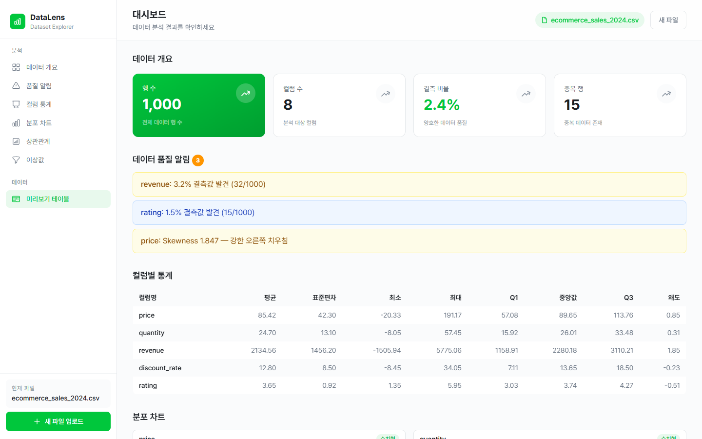

# DataLens

CSV나 JSON 파일을 올리면 분포, 상관관계, 이상값, 데이터 품질 문제를 바로 보여 주는 웹 기반 탐색적 데이터 분석(EDA) 도구입니다.

- 라이브: https://datalens-tau.vercel.app
- 백엔드는 무료 인스턴스라 한동안 요청이 없으면 잠듭니다. 첫 요청은 1분가량 걸릴 수 있고, 화면에 서버를 깨우는 중이라는 안내가 뜹니다.



## 왜 만들었나

데이터를 처음 받으면 분포를 보고, 결측과 이상값을 찾고, 컬럼끼리 상관을 확인하는 일을 매번 반복합니다. 노트북을 띄워 같은 코드를 다시 쓰는 대신, 파일을 끌어다 놓으면 이 첫 단계가 끝나도록 만들었습니다.

## 무엇을 하는가

- **업로드**: CSV·JSON을 끌어다 놓으면 파싱하고 컬럼을 숫자, 카테고리, 날짜, 텍스트 네 가지로 분류합니다. 파일은 10MB까지 받습니다.
- **미리보기**: 첫 50행을 가상화 테이블로 보여 줍니다.
- **분포**: 컬럼 타입에 따라 히스토그램, 막대 차트, 시계열 차트를 자동으로 고릅니다.
- **상관관계**: Pearson 상관계수 히트맵을 그리고, 칸을 누르면 두 컬럼의 산점도를 띄웁니다.
- **이상값**: IQR 기준으로 찾고, 토글로 차트에서 넣거나 뺍니다.
- **요약과 품질 알림**: 행·컬럼 수, 결측 비율, 중복 행 수를 보여 주고, 값이 하나뿐인 컬럼, 결측이 절반을 넘는 컬럼, 고유값이 지나치게 많은 카테고리 컬럼, 심하게 치우친 분포를 알려 줍니다.

## 구조

```text
 브라우저
   │  파일 업로드
   ▼
 React SPA (Vercel)                       frontend/
   │  상태: Zustand (dataset / analysis / ui 세 조각)
   │  REST (axios)
   ▼
 FastAPI (Render)                         backend/
   POST /api/upload    파싱 → 컬럼 타입 추론 → 메모리에 보관 → 미리보기 50행
   POST /api/analyze   통계 · 상관 · 이상값 · 품질 네 서비스를 동시에 실행
   POST /api/scatter   두 컬럼의 산점도 (최대 2,000점)
   GET  /health
```

- 프런트 상태는 원본 데이터(`datasetSlice`), 분석 결과(`analysisSlice`), 화면 상태(`uiSlice`)로 나눴습니다. 화면 상태는 `idle → uploading → analyzing → done`(또는 `error`)으로만 바뀝니다.
- 백엔드는 라우터(`app/api`)와 분석 서비스(`app/services`)를 분리했습니다. 서비스는 DataFrame을 받아 결과를 돌려주는 순수 함수라 HTTP 없이 테스트합니다.

## 설계 결정

**1. 분석은 브라우저가 아니라 서버에서 합니다.**
통계 계산에 pandas·numpy·scipy를 그대로 쓰기 위해서입니다. 브라우저의 Web Worker로 처리하는 방법도 있었지만, 같은 계산을 JavaScript로 다시 구현해야 하고 결과의 일관성을 따로 검증해야 합니다.

**2. 네 가지 분석을 스레드 풀에서 동시에 돌립니다.**
pandas 연산은 동기 함수라 그대로 호출하면 이벤트 루프가 막힙니다. `asyncio.gather`와 `run_in_executor`로 통계, 상관, 이상값, 품질 분석을 동시에 실행합니다(`backend/app/api/analyze.py`).

**3. 큰 데이터는 서버에서 줄여서 보냅니다.**
산점도는 2,000점을 넘으면 서버에서 표본을 뽑아 보냅니다. 표본 추출의 시드를 고정해 같은 요청에는 같은 그림이 나옵니다(`backend/app/api/scatter.py`). 미리보기 테이블과 이상값 목록은 `react-window`로 화면에 보이는 행만 그립니다.

**4. 차트 라이브러리를 용도에 따라 나눴습니다.**
분포 차트는 React 컴포넌트로 선언할 수 있는 Recharts를 씁니다. Recharts에는 히트맵이 없어서 상관관계 히트맵만 `@nivo/heatmap`을 씁니다.

**5. `any`를 쓰지 않습니다.**
프런트 소스에 `any` 타입이 없고, 빌드가 타입 검사를 포함합니다. API 응답 타입은 `frontend/src/types`에 모아 두고 컴포넌트 props는 `interface`로 선언합니다.

## 검증

| 대상 | 내용 | 결과 |
|---|---|---|
| 프런트엔드 | Vitest + React Testing Library, API는 MSW로 모킹 | 11개 파일 48건 통과 (작성 예정 표시 2건) |
| 프런트엔드 | ESLint, 타입 검사를 포함한 빌드(`tsc -b && vite build`) | 통과 |
| 백엔드 | pytest (분석 서비스, 업로드·산점도 API, CORS, 헬스 체크) | 62건 통과 |
| CI | PR이 열리면 프런트 린트·테스트·빌드와 백엔드 pytest를 실행하도록 구성 | `.github/workflows/ci.yml` |

```bash
cd frontend && pnpm test
cd backend && python -m pytest
```

## 기술 스택

| 구분 | 내용 |
|---|---|
| 프런트엔드 | React 19, TypeScript, Vite, Zustand, Recharts, @nivo/heatmap, react-window, Tailwind CSS 4 |
| 백엔드 | FastAPI, pandas, numpy, scipy |
| 테스트 | Vitest, React Testing Library, MSW, pytest |
| 배포·CI | Vercel(프런트), Render(백엔드), GitHub Actions |

## 로컬 실행

**백엔드**

```bash
cd backend
python -m venv venv
source venv/bin/activate    # Windows: venv\Scripts\activate
pip install -r requirements.txt
uvicorn main:app --reload   # http://localhost:8000
```

**프런트엔드**

```bash
cd frontend
pnpm install
pnpm dev                    # http://localhost:5173
```

환경 변수는 두 개입니다. 프런트의 `VITE_API_URL`(백엔드 주소, 기본값 `http://localhost:8000`)과 백엔드의 `ALLOWED_ORIGINS`(CORS 허용 origin, 쉼표로 구분)입니다.

`sample-data/demo-dataset.csv`는 바로 올려 볼 수 있는 예시 데이터입니다. 자율주행 차량의 센서 수집 로그 형태로 만든 60행짜리 가상 데이터입니다.

## 알려진 제한

- **데이터는 서버 메모리에만 있습니다.** 업로드한 파일은 DB나 파일로 저장하지 않으며, 서버가 재시작하면 사라집니다. 오래된 데이터를 지우는 만료 처리가 없습니다.
- **로그인이 없습니다.** 사용자별 저장이나 분석 이력 기능이 없습니다.
- **첫 요청이 느립니다.** 백엔드 무료 인스턴스가 잠들었다 깨어나는 데 1분가량 걸릴 수 있습니다.
- **파일 형식과 크기**: CSV와 JSON만 받고 10MB를 넘으면 거절합니다.
- **이상값은 IQR 한 가지 기준**이며, 상관관계는 숫자 컬럼의 Pearson 계수만 계산합니다.
